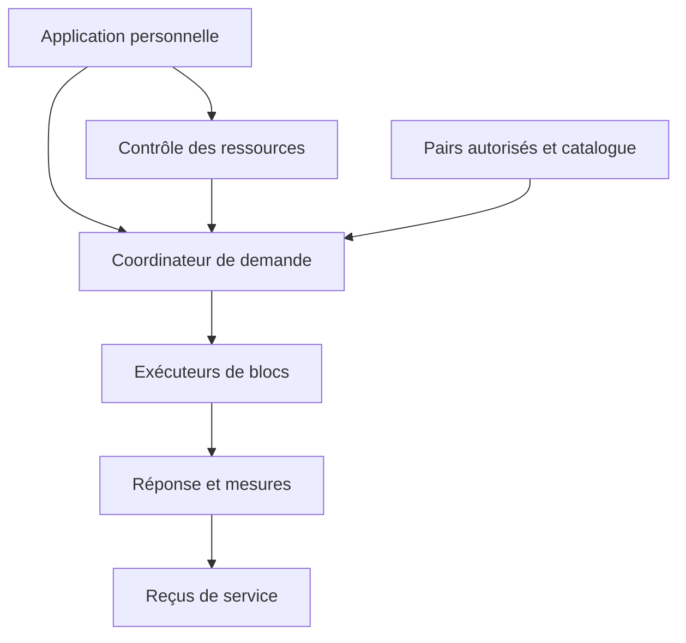

# Architecture du socle et de la cible

Le dossier PDF expose l’architecture complète proposée. Ce dépôt commence par des éléments indépendants du moteur afin de pouvoir comparer les moteurs existants sans présenter une intégration non réalisée.

| Couche | Réalisé dans 0.1 | Travail suivant |
|---|---|---|
| Politique de contribution | Calcul de quota hors ligne, validation des entrées | Mesures OS, admission continue et contrôle réel du processus |
| Placement | Faisabilité gloutonne sur couches uniformes fictives | Profils par bloc réel, coûts réseau et temps mesurés |
| Référence locale | Client de benchmark Ollama fourni, parseur testé | Exécuter sur le matériel et vérifier la qualité |
| Inférence partagée | Catalogue et protocole de comparaison | Choisir et intégrer un moteur après mesures |
| Maillage | Schéma et contrat d’entrée documentés | Découverte, invitations, authentification, relais, reprise |
| Interface utilisateur | Parcours documenté | Application installable, signée, avec contrôles locaux |
| Registre | Choix de reçus hors chemin interactif | Journal local, signatures et vérifications |

## Unités et quotas

Les octets sont les unités internes ; Go décimal = 1 000 000 000 octets. Le budget inclut poids, KV, moteur et buffers. Le programme n’alloue pas la mémoire et ne garantit pas de plafond système à 20 %. Sous mémoire unifiée, CPU et GPU ne sont pas additionnés comme deux réserves séparées.

`quota_bytes` utilise un instantané avant admission. Dans un futur agent déjà actif, normaliser la capacité disponible pour éviter de soustraire deux fois sa propre allocation ou d’ajouter une mémoire déjà récupérable selon l’OS.

## Limites du planificateur

`plan` ne combine que des participants autorisés du même cercle et du même backend. Il répartit une estimation uniforme par couche, dans l’ordre décroissant de capacité, puis refuse tout plan incomplet. Il n’optimise pas la latence et ne connaît ni les embeddings irréguliers ni les experts d’un vrai modèle. Il faut des profils de blocs réels avant toute réservation effective.

## Données et reprise

Les conversations restent locales ou dans un cercle choisi pour les traiter. Une machine exécutant un bloc peut accéder aux informations qu’elle reçoit ; TLS n’empêche pas cela. Le journal de reprise associera session, tentative, version de plan et tokens validés. Une copie des poids ne possède pas automatiquement le cache KV.

Le maillage transportera les calculs nécessaires. La blockchain éventuelle restera hors de ce chemin ; elle n’est ni une mémoire rapide ni une preuve automatique du travail correct.
