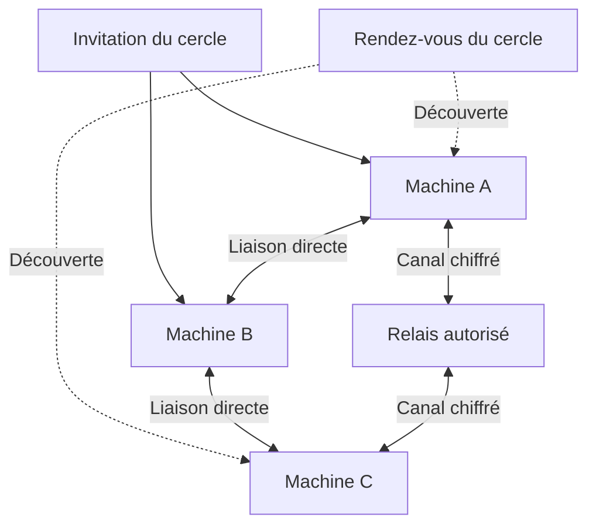

# Former le réseau maillé

**Spécification proposée ; fonctions réseau non implémentées dans le socle 0.1.**

Un réseau maillé relie plusieurs machines par plusieurs chemins possibles. Il ne demande pas une connexion permanente de chaque machine à toutes les autres. Mille machines reliées deux à deux représenteraient 499 500 liaisons : ce n’est pas le plan proposé.

## Trois réseaux à distinguer

1. **Découverte et contrôle** : trouver les participants, vérifier leur droit d’entrer et connaître leurs ressources.
2. **Calcul** : relier seulement les nœuds retenus pour une demande ; quelques blocs successifs peuvent former une chaîne au sein du maillage.
3. **Comptabilité** : échanger des reçus après le travail. Cette couche n’impose aucune blockchain au démarrage.

Le relais ne remplace pas les permissions de calcul. Chiffrer le transport ne cache pas les données à la machine qui doit les traiter. Un lien disponible n’implique pas qu’il convient à l’inférence interactive.

## Créer le premier cercle

Le propriétaire crée son identité locale et nomme le cercle. Une invitation contient l’identifiant du cercle, sa clé d’autorité ou son empreinte, les adresses de rendez-vous et un jeton limité dans le temps. Elle ne contient aucune clé privée. L’ajout d’un appareil exige une validation des droits et de sa clé ; un appareil découvert sur le Wi-Fi n’est pas automatiquement autorisé.

Le prototype initial peut utiliser un seul rendez-vous assumé comme point de dépendance. Une deuxième référence de rendez-vous est ajoutée avant de revendiquer une continuité indépendante de la machine du créateur. Les pairs conservent leurs contacts autorisés et les offres expirent rapidement. Un coordinateur est choisi par demande ; il n’existe pas nécessairement de serveur central pour tous les calculs.

## Rejoindre depuis un autre ordinateur

1. Ouvrir l’invitation dans l’application et vérifier le nom du cercle et son créateur.
2. Échanger les clés publiques et obtenir l’autorisation explicite d’entrer.
3. Annoncer le moteur, les formats, le quota et les types de tâches acceptés.
4. Tester une petite liaison et un calcul sans données privées.
5. Afficher les voisins accessibles, le type de connexion et la capacité réellement admise.

## Trouver un chemin

Sur un réseau local, une découverte de type mDNS peut signaler les voisins ; l’authentification reste obligatoire. À distance, un service de rendez-vous permet l’introduction des pairs. La traversée NAT et le relais doivent être confiés à des composants éprouvés : réseau privé existant pour le premier pilote, mécanismes de connexion pair à pair dédiés seulement après validation.

Pour un pilote sur invitation, Tailscale ou une infrastructure Headscale administrée peuvent simplifier l’adressage. Ils demandent leur propre configuration et ne suppriment pas les délais physiques. Ce dépôt ne crée ni compte, ni réseau VPN, ni ouverture de port.

Si une liaison directe échoue, un relais autorisé peut transporter un canal chiffré entre les extrémités. Son délai et son débit entrent dans le placement. Si la liaison est trop lente, le nœud reçoit des travaux autonomes, ou n’est pas retenu pour cette demande.

## Résister aux départs et limiter le trafic

Les annonces ont une durée de validité et des numéros de version. Les nœuds échangent de petits résumés de changements avec un nombre borné de voisins. Le degré, les délais et la fréquence des battements de présence sont des paramètres à mesurer, pas des constantes universelles. Le protocole doit démontrer sa connectivité, y compris lors de partitions.

Un participant qui disparaît est retiré des nouveaux plans. Les requêtes touchées utilisent une copie compatible et reconstruisent leur contexte, ou signalent leur échec. Avoir plusieurs chemins réseau ne suffit pas si le bloc de modèle ou le cache de session est perdu.

La révocation d’un appareil est signée, versionnée et propagée. Les autorisations expirent : un appareil isolé ne conserve pas indéfiniment un ancien droit. Les nouvelles sessions vérifient cet état. Les détails cryptographiques seront figés avant développement du protocole public.

## Ce qu’il faut tester avant d’écrire « réseau opérationnel »

- Deux machines distinctes se découvrent et s’autorisent réellement.
- Un appareil non invité est refusé ; une invitation expirée est inutilisable.
- Une coupure d’un rendez-vous n’efface pas les sessions déjà compatibles ; la dépendance restante est affichée.
- Un changement Wi-Fi/Ethernet ou un relais ne produit pas de fausse promesse de débit.
- Le retrait d’un participant et l’arrêt volontaire libèrent les ressources dans un délai mesuré.

Références : [mDNS, RFC 6762](https://www.rfc-editor.org/rfc/rfc6762), [STUN, RFC 8489](https://www.rfc-editor.org/rfc/rfc8489), [TURN, RFC 8656](https://www.rfc-editor.org/rfc/rfc8656), [Headscale](https://github.com/juanfont/headscale), [Tailscale](https://tailscale.com/docs/how-to/quickstart).
